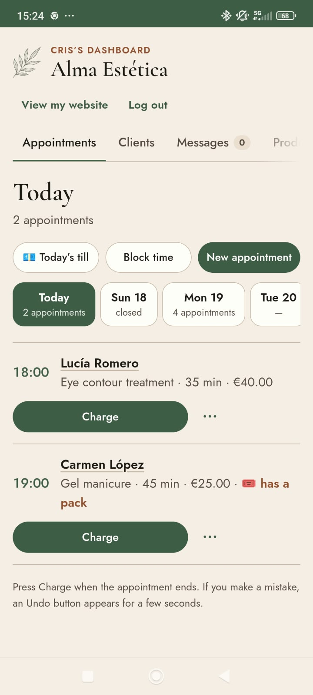
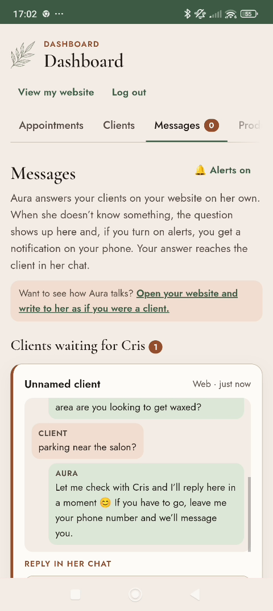
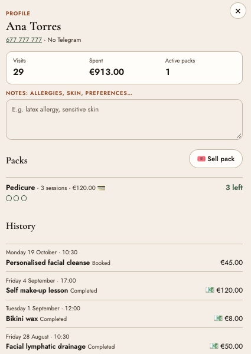

# Alma · an open-source AI receptionist for a one-person beauty salon

**Alma** is a simple dashboard for a small beauty salon. **Aura** is its receptionist, powered by **Gemma 4**, an open model. She answers clients on the salon's website at any hour, in Spanish or English: prices, opening hours, recommendations, and booking, changing or cancelling appointments. When something needs the owner (an allergy, a complaint, a discount), Aura passes it on and the owner's phone buzzes.

**The model proposes, the code decides.** Gemma never touches the database. Availability, bookings, health questions and money are handled by tested Python.

- 🌐 **Live:** https://almaestetica.tech
- 🔑 **Owner dashboard:** https://almaestetica.tech/panel
- 📝 **Write-up:** the DEV post for the Hacktoberfest 2026 Open-Source AI Challenge
- 🇪🇸 [Versión en español](README.es.md)

| Today's appointments | A question for the owner | Client file |
|---|---|---|
|  |  |  |

---

## What it does

**For clients (the salon's website)**
- Treatments and prices, opening hours, and online booking that only offers slots where the whole treatment fits.
- **Aura**, a chat receptionist (Gemma 4) that answers in the client's language and books with real one-tap slot buttons.

**For the owner (`/panel`)**
- **Appointments:** one *Charge* button per appointment (cash, card or Bizum, with undo), walk-ins, blocked time and *Today's till*.
- **Clients:** notes (allergies, skin type), visits, packs and history.
- **Messages:** what Aura couldn't answer. The owner replies there and the answer reaches the client in her chat. **Web Push** alerts, one per client.
- **Reminders:** sent 24 h before each appointment, plus "time to repeat your treatment" messages, every hour by a cron job.
- **Products:** stock is forecast from the booked appointments. Gemma drafts the supplier order and the owner approves it. **Compare prices** searches Google Shopping through **SerpApi**.

## How Aura stays honest

Every client message goes through code first, then Gemma, then code again.

```
Client (web chat) ─► Django API ─┬─ guardrails in code (off-topic, health, owner-only topics) ─► owner
                                 │
                                 └─► Gemma 4 (Ollama) ─► JSON {reply, action}
                                                              │
                                    validation in code ◄──────┘
                                    (real slots, real bookings, no false claims)
```

- **Some things never reach the model.** Off-topic requests, health questions (allergies, pregnancy, medication) and owner-only topics (discounts, complaints, gift vouchers…) go straight to the owner.
- **Gemma returns one action** (`offer_slots`, `book`, `cancel`, `handoff` or `none`) in schema-constrained JSON. The code validates it before doing anything.
- **The model can't decide availability.** If the client wants a slot, or Gemma says anything about the diary ("we're fully booked", "no openings"), the code shows the **real** free slots.
- **No false claims.** "You're booked!" without a `book` action is replaced with real buttons.
- **Fallback.** If Gemma is down or slow, a rules-based receptionist answers, so a client can always book.
- **Traces.** Every call is logged as `gemma_call ms= prompt_tokens= output_tokens=`, every decision as `aura_decision proposed= result= guard=`, and every fallback as `aura_fallback`.

### Measured, not guessed

`python manage.py eval_aura` runs 60 realistic client messages (ES/EN): bookings, prices, health questions, owner-only questions, off-topic and prompt injection. Each message runs in a rolled-back transaction, so nothing is saved or sent. It compares the rules-only receptionist with Gemma and writes a CSV and a Markdown summary to [`backend/eval_results/`](backend/eval_results/).

| 60 messages | Rules only | Gemma 4, first run | Gemma 4 + guardrails |
|---|---|---|---|
| **Total** | 90% | 78% | **98%** |

```bash
python manage.py eval_aura            # rules vs Gemma
python manage.py eval_aura --mode ai  # Gemma only
```

The guardrails were designed after seeing these 60 messages, so 98% is optimistic. A held-out set is next.

---

## Stack and architecture

Python 3.12, Django 5.2, Django REST Framework, PostgreSQL, pytest · React + Vite · Gemma 4 via Ollama (Ollama Cloud or local, same code) · Web Push (VAPID) · SerpApi · Render.

The backend is **hexagonal** with **CQRS**: infrastructure knows the application, the application knows the domain, and the domain knows nobody.

```
backend/
├── domain/          entities, repository and service interfaces, pure rules (slots, stock, client messages, intent detection)
├── application/     commands/<action>/ (change data) · queries/<query>/ (read only) · shared/ (the receptionist)
├── infrastructure/  api/<view>/, Django ORM repositories, Ollama / SerpApi / Web Push / email / Telegram services, management commands
└── tests/           same structure, 300+ tests; the model, messaging and email are faked, so no network is needed
```

## Run it locally

```bash
cp backend/.env.example backend/.env
docker compose up --build
docker compose exec backend python manage.py seed_demo
```

- Salon website: http://localhost:5173
- Owner dashboard: http://localhost:5173/panel

If you don't use Docker, run `poetry install`, then `migrate`, `seed_demo` and `runserver` in `backend/`, and `npm install` and `npm run dev` in `frontend/`. Without `DATABASE_URL` it uses SQLite.

**AI.** Set `LLM_ENABLED=true` and choose where Gemma runs:
- **Ollama Cloud:** `OLLAMA_URL=https://ollama.com`, `OLLAMA_MODEL=gemma4:31b` and `OLLAMA_API_KEY`.
- **Local Ollama:** `OLLAMA_URL=http://localhost:11434` with a Gemma model you've pulled.

Check the connection with `python manage.py check_ai`. Without AI the app still works: Aura answers with rules.

**Optional keys:** `SERPAPI_API_KEY` (price comparison) and `VAPID_*` (push notifications).

**Tests:**

```bash
cd backend && poetry run pytest
```

## Deploy on Render

[`render.yaml`](render.yaml) is a Blueprint (**New → Blueprint**). It creates:

| Service | Type |
|---|---|
| `alma-db` | PostgreSQL |
| `alma-backend` | Web service (Docker), always on |
| `alma-frontend` | Static site |
| `alma-reminders` | Cron job, `0 * * * *` → `python manage.py send_notifications` |
| `alma-settings` | Environment group (business details, AI, SerpApi, VAPID) |

The live demo uses a custom domain (`almaestetica.tech` and `api.almaestetica.tech`) with automatic TLS. `DEMO_HINTS=false` hides the demo hints.

## White label

The business name, owner, address and assistant name come from environment variables. Treatments, products, opening hours and keywords are edited in the admin. The same app works for another salon, a hairdresser or a nail studio. Rename Aura.

## License

[MIT](LICENSE)
